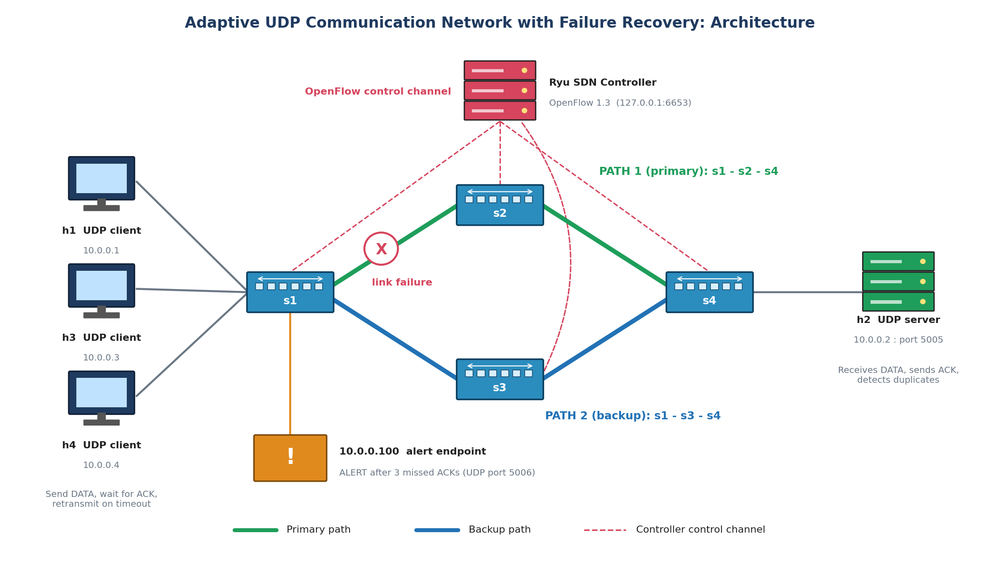
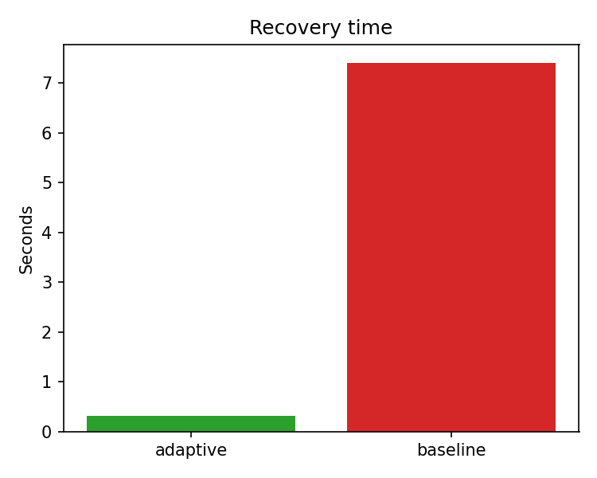
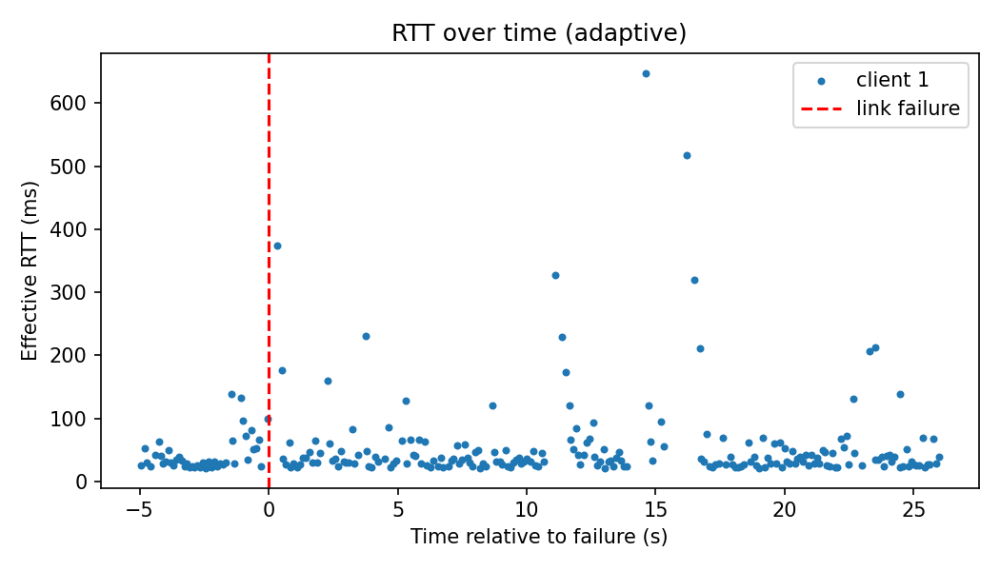
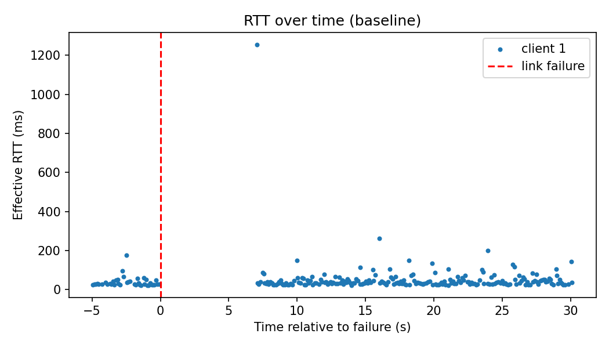

# Adaptive Communication Network with Failure Recovery

**Computer Networks mini project** | Manoj Kumar S (CS293) · Mathanghi Sivakumar (CS296) · Madhusudhan R (CS286)

A UDP client-server application runs on a Mininet network that has **two paths** between the clients and the server.
A **Ryu SDN controller** detects a failed link or switch and **reroutes the traffic** to the other path.
Because UDP has no reliability, the application adds its own: **sequence numbers, ACKs, timeouts and retransmission**.
We measure recovery time, packet loss and RTT, and compare against a **baseline controller that never reroutes**.



---

## 1. Results at a glance

36 experiment runs (18 adaptive, 18 baseline): 1 to 3 clients, 2 sending rates, 3 repeats each.
In every run the link s1-s2 goes down at 5 s and comes back at 12 s. Values are averages over all runs.

| Metric | Adaptive | Baseline | Change |
|---|---|---|---|
| Recovery time | 0.32 s | 7.40 s | -96 % |
| Packets lost for good | 0.00 % | 1.19 % | -100 % |
| Lost transmissions (all attempts) | 0.7 % | 12.1 % | -95 % |
| RTT during the failure | 211 ms | 1349 ms | -84 % |
| RTT before the failure | 42 ms | 35 ms | +19 % |





**What this means**
- **Recovery:** the adaptive controller restores traffic in about 0.3 s. The baseline only recovers when the failed link comes back, about 7.4 s later (that wait is set by the experiment: down at 5 s, up at 12 s).
- **Loss:** the adaptive system loses no packets for good. The baseline loses 1.2 % for good and 12 % of all transmissions. The client sends one packet at a time, so only a few packets give up in absolute terms.
- **RTT:** normal RTT is about 35 to 42 ms for both. During the failure it rises to 211 ms (adaptive) against 1349 ms (baseline). The small differences before and after the failure are run-to-run noise.
- All numbers, with standard deviations and breakdowns by clients and rate: [`results/final_numbers.md`](results/final_numbers.md).
- Full write-up with all 36 runs: [`docs/REPORT.md`](docs/REPORT.md).

### Challenging scenarios (2 clients, 10 packets/s, one run each)

| Scenario | Controller | Lost for good | Lost transmissions | Notes |
|---|---|---|---|---|
| 5 % packet loss on the links | adaptive | 0.0 % | 18.48 % | all 600 packets delivered |
| | baseline | 0.67 % | 25.87 % | |
| Both paths down, then restored | adaptive | 1.0 % | 8.62 % | controller logs `NO_PATH`, keeps running, restores paths |
| | baseline | 1.33 % | 12.81 % | |
| Repeated failures (s1-s2, then s1-s3) | adaptive | 0.0 % | 0.5 % | reroutes after each failure |
| | baseline | 0.33 % | 5.68 % | |

Recovery time in these scenarios is measured from the first failure only, so compare the loss columns.

---

## 2. How it works

1. **Topology:** four hosts (h1, h3, h4 clients; h2 server) and four OpenFlow switches in a diamond. Path 1 is s1-s2-s4 and path 2 is s1-s3-s4.
2. **Controller (Ryu):** discovers the topology, answers ARP itself (avoids broadcast storms in the loop), computes shortest paths and installs flow rules in both directions.
3. **Failure handling:** port-status and link-delete events remove the link from the graph. Affected flows get a new path (`REROUTE`). When the link returns, flows go back to the preferred path (`RESTORE`). If no path exists, the controller logs `NO_PATH` and keeps running.
4. **UDP application:** each packet carries a sequence number and is acknowledged. A missing ACK after 0.3 s causes a retransmission (up to 8 times). The server detects duplicates.
5. **Socket-SDN link:** after 3 missed ACKs in a row a client sends an `ALERT` to the controller (UDP 5006), which re-checks that flow. Alerts were received in the saved runs `scen_bothdown_adaptive` and `scen_loss5_adaptive`.
6. **Baseline:** the same controller with adaptation switched off. It never reroutes.

Packet format: `type (1 B) | client ID (2 B) | sequence number (4 B) | timestamp (8 B) | payload`.

---

## 3. Run it yourself

**Needs:** Ubuntu 20.04, Python 3.8, Mininet 2.3.0 (installed from source), Open vSwitch, and `sudo pip3 install -r requirements.txt` (Ryu 4.34, eventlet 0.30.2, networkx, matplotlib).

**Manual demo** (run from the project folder; start Ryu first):
```bash
# terminal 1
ryu-manager controller/adaptive_controller.py --observe-links
# terminal 2
sudo python3 topology/topo.py
```
At the `mininet>` prompt:
```
pingall
h2 python3 app/udp_server.py results/demo_server.log &
h1 python3 app/udp_client.py 10.0.0.2 --client-id 1 --rate 10 --count 600 --log results/demo_client_1.log --alert-ip 10.0.0.100 &
link s1 s2 down
link s1 s2 up
```
Other failures: `link s2 s4 down`, `switch s2 stop` / `switch s2 start`.

**Automatic experiments** (about 45 minutes for the full matrix):
```bash
sudo env "PATH=$PATH" python3 experiments/run_experiment.py --controller adaptive --clients 2 --rate 10 --count 250
sudo env "PATH=$PATH" bash experiments/run_all.sh          # 36 runs
sudo env "PATH=$PATH" bash experiments/run_scenarios.sh    # loss, both paths down, repeated failures
python3 analysis/analyze_logs.py                           # writes results/summary.csv
python3 analysis/plot_results.py                           # writes results/graphs/*.png
python3 analysis/final_numbers.py                          # writes results/final_numbers.md
```
`sudo env "PATH=$PATH"` lets root find `ryu-manager`. Options of `run_experiment.py`: `--controller adaptive|baseline`, `--clients`, `--rate`, `--count`, `--delay`, `--loss`, `--event down:s1-s2@5 --event up:s1-s2@12`, `--run-id`.

---

## 4. Repository layout

| Folder / file | What it is |
|---|---|
| `app/` | `protocol.py` (packet format), `udp_server.py`, `udp_client.py` |
| `controller/` | `adaptive_controller.py` (Ryu app), `baseline_controller.py` (never reroutes) |
| `topology/topo.py` | Mininet diamond topology |
| `experiments/` | `run_experiment.py` (one run), `run_all.sh` (36 runs), `run_scenarios.sh` |
| `analysis/` | `analyze_logs.py`, `plot_results.py`, `final_numbers.py` |
| `results/summary.csv` | One row per run: loss, RTT, recovery time, throughput |
| `results/scenarios_summary.csv` | The three challenging scenarios |
| `results/final_numbers.md` | Averages, standard deviations, breakdowns |
| `results/graphs/` | Charts used above |
| `results/logs/`, `results/scenarios/` | Raw logs of every run: client logs, server log, `controller.csv`, `events.csv`, `config.json` |
| `results/evidence/` | Controller events, flow tables and tables from the demo |
| `tests/test_cases.md` | Test cases with the actual results |
| `docs/` | Architecture diagram and `REPORT.md` (final report with the 36-run comparison and conclusion) |

## 5. Metrics

| Metric | Meaning |
|---|---|
| Recovery time | First successful ACK after the failure minus the failure time (worst client) |
| Lost for good | Packets that never got an ACK after all retries |
| Lost transmissions | Lost attempts divided by all attempts, retries included |
| RTT | ACK time minus the first send time of a packet, so it includes retransmission waits |
| Throughput | Delivered payload bits per second |

## 6. Limitations

- The network is emulated on one machine, so absolute times depend on the VM.
- The scenarios were run once each. The main matrix has 3 repeats per condition.
- Flow rules match on IP addresses, not on UDP ports. The controller does no load balancing.
- The client sends one packet at a time (stop-and-wait) and does not send heartbeats.

## 7. Conclusion

Adding an SDN controller to a reliable-UDP application gives a network that heals itself. Over 36 runs the adaptive system restored traffic in **0.32 s instead of 7.40 s (23× faster)**, delivered **all 6750 packets** (baseline lost 71 for good), cut wasted transmissions from **12.1 % to 0.65 %**, kept RTT during a failure **6.4× lower** (211 ms vs 1349 ms) and gave **23.8 % more throughput**, with no extra delay in normal operation. It held for 1 to 3 clients, both sending rates, 5 % packet loss, repeated failures and even a both-paths-down event. Full details: [`docs/REPORT.md`](docs/REPORT.md).
