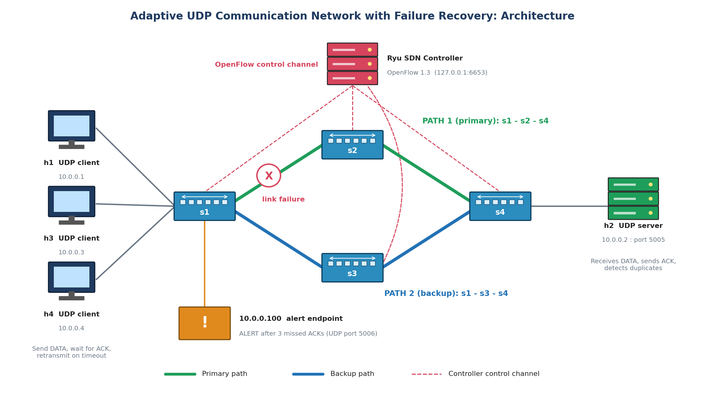
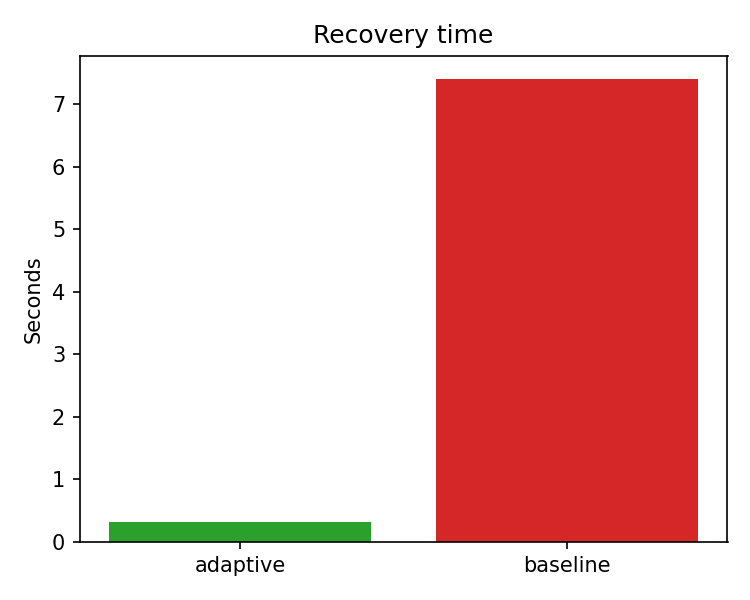
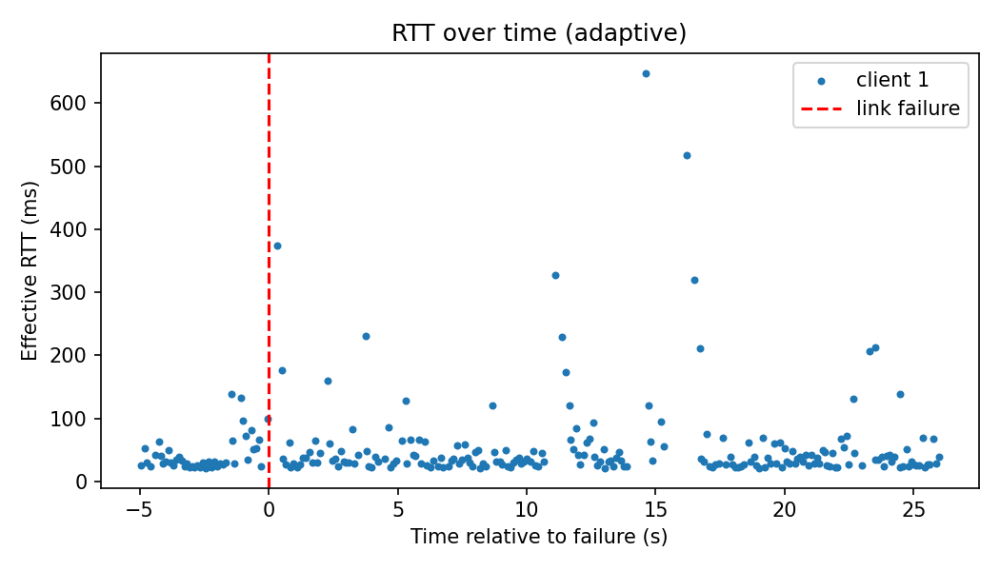
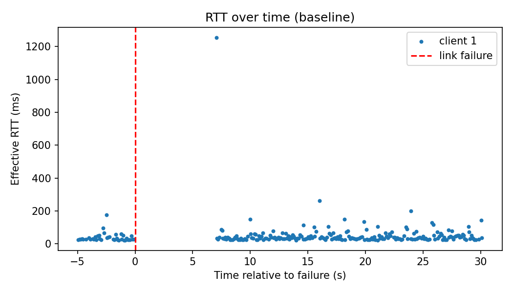

# Final Report: Adaptive Communication Network with Failure Recovery

**Course:** Computer Networks mini project, PES University
**Team:** Manoj Kumar S (CS293) · Mathanghi Sivakumar (CS296) · Madhusudhan R (CS286)
**Date:** November 2026

---

## 1. Problem statement and objectives

Links and switches fail in real networks. A plain UDP application has no way to recover, so packets are lost and the user sees a stall. Our goal was a UDP communication framework in which an **SDN controller detects the failure and moves the traffic to another path by itself**, and the application adds its own reliability on top of UDP.

Objectives we set, and the result for each:

| Objective | Result |
|---|---|
| Implement UDP client-server communication | Done: sequence numbers, ACKs, timeouts, retransmission, duplicate detection |
| Create multiple network paths | Done: diamond topology with two paths (s1-s2-s4 and s1-s3-s4) |
| Monitor topology and link status | Done: Ryu discovers switches and links, and watches port-status and link-delete events |
| Simulate link/path failures | Done: `link down/up`, switch stop/start, repeated and double failures |
| Detect failures dynamically | Done: controller logs `LINK_DOWN` in under 1 ms of the event |
| Reroute application traffic | Done: `REROUTE` installed within about 2 ms, `RESTORE` when the link returns |
| Implement application-level recovery | Done: up to 8 retransmissions, 0.3 s timeout, client `ALERT` to the controller |
| Measure recovery time, packet loss and latency | Done: 36 controlled runs plus 6 challenging-scenario runs |

## 2. System architecture

- **Hosts:** h1, h3, h4 are UDP clients. h2 is the UDP server.
- **Switches:** four Open vSwitch switches (s1 to s4) in a diamond, speaking OpenFlow 1.3.
- **Controller:** a Ryu application. It builds a graph of the network, answers ARP itself, computes the shortest path with NetworkX and installs flow rules in both directions.
- **Application:** UDP client and server in `app/`. Packet format: `type (1 B) | client ID (2 B) | sequence (4 B) | timestamp (8 B) | payload`.
- **Alert channel:** after 3 missed ACKs in a row a client sends an `ALERT` to the controller on UDP port 5006.
- **Baseline:** the same controller with adaptation switched off. This gives a fair comparison, because only one thing differs.

## 3. Implementation

### 3.1 UDP application and protocol design
Each packet has a sequence number and is acknowledged. If no ACK arrives within 0.3 s, the client sends the packet again (up to 8 times). The server keeps a set of seen sequence numbers per client, so it can mark duplicates. Malformed packets are counted and ignored, and the server keeps running (`# malformed_packets=0` in all 36 runs). Several clients run at the same time, each with its own client ID.

### 3.2 Mininet topology
`topology/topo.py` builds four hosts and four switches. Core links have 10 Mbps bandwidth and 5 ms delay (optional packet loss). A remote Ryu controller manages all switches.

### 3.3 Ryu controller
- **Discovery:** `SWITCH_UP` and `LINK_UP` events build the graph.
- **Failure detection:** both `port_status` and LLDP link-delete events remove the failed link.
- **Reroute:** every flow whose path used the failed link is recomputed (`FLOW_AFFECTED`, then `REROUTE`).
- **Restore:** when the link returns, flows go back to the preferred path (`RESTORE`).
- **No path:** if both paths are down the controller logs `NO_PATH`, keeps running and recovers when a link returns.

### 3.4 Socket-SDN integration
Application events reach the controller through the `ALERT` message. The controller checks the flow and refreshes its rules (`ALERT_RECEIVED`, `ALERT_REFRESH`). This was seen in the packet-loss and both-paths-down scenarios. In the main runs the network-side detection was fast enough that the application alert was not needed, which is a good sign for the controller.

## 4. Testing

All 16 test cases and their actual results are in [`tests/test_cases.md`](../tests/test_cases.md). In short: connectivity, topology discovery, normal transfer, primary path use, multiple clients, link failure and reroute, application recovery, restore, baseline comparison, packet loss, both paths down, repeated failures and the full performance matrix all behaved as expected.

## 5. Performance evaluation: adaptive vs baseline (36 runs)

**Experiment design.** 36 runs = 2 controllers × 3 client counts (1, 2, 3) × 2 sending rates (5 and 10 packets/s) × 3 repeats. In every run link s1-s2 goes down at 5 s and comes back at 12 s. Each run lasts about 25 s.

**Metrics.** *Recovery time:* first successful ACK after the failure minus the failure time (worst client). *Lost for good:* packets with no ACK after all retries. *Lost attempts:* lost transmissions divided by all transmissions, retries included. *RTT:* ACK time minus the first send time. *Throughput:* delivered payload bits per second.

### 5.1 Headline results (all 36 runs)

| Metric | Adaptive | Baseline | Improvement |
|---|---|---|---|
| Recovery time | **0.32 s** (std 0.09) | 7.40 s (std 0.32) | **23× faster** (-95.6 %) |
| Packets delivered | **6750 of 6750 (100 %)** | 6679 of 6750 (98.95 %) | **zero permanent loss** |
| Lost for good | **0.00 %** | 1.19 % | -100 % |
| Lost attempts (retries included) | **0.65 %** | 12.11 % | **18× fewer** (-94.6 %) |
| RTT during failure | **211 ms** | 1349 ms | **6.4× lower** (-84.4 %) |
| Throughput | **6.90 kbps** | 5.58 kbps | **+23.8 %** |
| RTT before failure | 41.8 ms | 35.0 ms | about the same (run-to-run noise, std about 10 to 13 ms) |
| RTT after failure | 41.0 ms | 37.8 ms | about the same |

### 5.2 Results for each of the 6 conditions (mean of 3 repeats; adaptive in bold)

| Clients | Rate (pkt/s) | Recovery time, adaptive / baseline (s) | Lost for good, adaptive / baseline (%) | Lost attempts, adaptive / baseline (%) | RTT during failure, adaptive / baseline (ms) |
|---|---|---|---|---|---|
| 1 | 5 | **0.24** / 7.32 | **0.00** / 1.60 | **0.26** / 16.13 | **147** / 1596 |
| 1 | 10 | **0.36** / 7.21 | **0.00** / 0.80 | **1.05** / 8.49 | **357** / 1562 |
| 2 | 5 | **0.29** / 7.29 | **0.00** / 1.60 | **0.92** / 15.94 | **242** / 1185 |
| 2 | 10 | **0.34** / 7.66 | **0.00** / 0.80 | **0.33** / 8.82 | **219** / 1823 |
| 3 | 5 | **0.31** / 7.32 | **0.00** / 1.60 | **0.87** / 15.23 | **134** / 910 |
| 3 | 10 | **0.41** / 7.58 | **0.00** / 0.76 | **0.49** / 8.03 | **167** / 1017 |

**What the table shows.**
- Adaptive recovery stays between **0.24 s and 0.41 s** in every condition. It does not grow with more clients or a higher rate, so the solution scales across the tested range.
- Adaptive lost **no packet for good in any of the 18 runs**. Baseline lost packets in all 18 of its runs.
- With more clients the adaptive system gives more total throughput (3.3 kbps with 1 client, 7.0 with 2, 10.5 with 3) while keeping recovery at about 0.3 s.

### 5.3 All 36 runs

| # | Run ID | Controller | Clients | Rate | Sent | Delivered | Lost for good (%) | Lost attempts (%) | RTT during failure (ms) | Recovery (s) |
|---|---|---|---|---|---|---|---|---|---|---|
| 1 | adaptive_c1_r5_rep1 | adaptive | 1 | 5 | 125 | 125 | 0.0 | 0.79 | 361 | 0.377 |
| 2 | adaptive_c1_r5_rep2 | adaptive | 1 | 5 | 125 | 125 | 0.0 | 0.0 | 54 | 0.224 |
| 3 | adaptive_c1_r5_rep3 | adaptive | 1 | 5 | 125 | 125 | 0.0 | 0.0 | 26 | 0.131 |
| 4 | adaptive_c1_r10_rep1 | adaptive | 1 | 10 | 250 | 250 | 0.0 | 1.96 | 374 | 0.338 |
| 5 | adaptive_c1_r10_rep2 | adaptive | 1 | 10 | 250 | 250 | 0.0 | 0.4 | 349 | 0.37 |
| 6 | adaptive_c1_r10_rep3 | adaptive | 1 | 10 | 250 | 250 | 0.0 | 0.79 | 348 | 0.378 |
| 7 | adaptive_c2_r5_rep1 | adaptive | 2 | 5 | 250 | 250 | 0.0 | 0.79 | 373 | 0.386 |
| 8 | adaptive_c2_r5_rep2 | adaptive | 2 | 5 | 250 | 250 | 0.0 | 0.0 | 25 | 0.121 |
| 9 | adaptive_c2_r5_rep3 | adaptive | 2 | 5 | 250 | 250 | 0.0 | 1.96 | 330 | 0.363 |
| 10 | adaptive_c2_r10_rep1 | adaptive | 2 | 10 | 500 | 500 | 0.0 | 0.4 | 233 | 0.353 |
| 11 | adaptive_c2_r10_rep2 | adaptive | 2 | 10 | 500 | 500 | 0.0 | 0.2 | 99 | 0.33 |
| 12 | adaptive_c2_r10_rep3 | adaptive | 2 | 10 | 500 | 500 | 0.0 | 0.4 | 324 | 0.324 |
| 13 | adaptive_c3_r5_rep1 | adaptive | 3 | 5 | 375 | 375 | 0.0 | 0.0 | 45 | 0.24 |
| 14 | adaptive_c3_r5_rep2 | adaptive | 3 | 5 | 375 | 375 | 0.0 | 0.53 | 174 | 0.344 |
| 15 | adaptive_c3_r5_rep3 | adaptive | 3 | 5 | 375 | 375 | 0.0 | 2.09 | 184 | 0.341 |
| 16 | adaptive_c3_r10_rep1 | adaptive | 3 | 10 | 750 | 750 | 0.0 | 1.06 | 275 | 0.373 |
| 17 | adaptive_c3_r10_rep2 | adaptive | 3 | 10 | 750 | 750 | 0.0 | 0.13 | 67 | 0.37 |
| 18 | adaptive_c3_r10_rep3 | adaptive | 3 | 10 | 750 | 750 | 0.0 | 0.27 | 157 | 0.48 |
| 19 | baseline_c1_r5_rep1 | baseline | 1 | 5 | 125 | 123 | 1.6 | 16.89 | 1662 | 7.389 |
| 20 | baseline_c1_r5_rep2 | baseline | 1 | 5 | 125 | 123 | 1.6 | 16.33 | 1846 | 7.353 |
| 21 | baseline_c1_r5_rep3 | baseline | 1 | 5 | 125 | 123 | 1.6 | 15.17 | 1280 | 7.22 |
| 22 | baseline_c1_r10_rep1 | baseline | 1 | 10 | 250 | 248 | 0.8 | 8.15 | 1256 | 7.051 |
| 23 | baseline_c1_r10_rep2 | baseline | 1 | 10 | 250 | 248 | 0.8 | 8.82 | 1833 | 7.326 |
| 24 | baseline_c1_r10_rep3 | baseline | 1 | 10 | 250 | 248 | 0.8 | 8.49 | 1598 | 7.241 |
| 25 | baseline_c2_r5_rep1 | baseline | 2 | 5 | 250 | 246 | 1.6 | 15.75 | 693 | 7.348 |
| 26 | baseline_c2_r5_rep2 | baseline | 2 | 5 | 250 | 246 | 1.6 | 16.33 | 1833 | 7.322 |
| 27 | baseline_c2_r5_rep3 | baseline | 2 | 5 | 250 | 246 | 1.6 | 15.75 | 1028 | 7.192 |
| 28 | baseline_c2_r10_rep1 | baseline | 2 | 10 | 500 | 496 | 0.8 | 8.82 | 2360 | 8.357 |
| 29 | baseline_c2_r10_rep2 | baseline | 2 | 10 | 500 | 496 | 0.8 | 8.82 | 1231 | 7.326 |
| 30 | baseline_c2_r10_rep3 | baseline | 2 | 10 | 500 | 496 | 0.8 | 8.82 | 1879 | 7.309 |
| 31 | baseline_c3_r5_rep1 | baseline | 3 | 5 | 375 | 369 | 1.6 | 13.99 | 483 | 7.325 |
| 32 | baseline_c3_r5_rep2 | baseline | 3 | 5 | 375 | 369 | 1.6 | 15.75 | 1528 | 7.272 |
| 33 | baseline_c3_r5_rep3 | baseline | 3 | 5 | 375 | 369 | 1.6 | 15.95 | 718 | 7.354 |
| 34 | baseline_c3_r10_rep1 | baseline | 3 | 10 | 750 | 744 | 0.8 | 7.92 | 394 | 7.265 |
| 35 | baseline_c3_r10_rep2 | baseline | 3 | 10 | 750 | 745 | 0.67 | 7.34 | 1272 | 8.117 |
| 36 | baseline_c3_r10_rep3 | baseline | 3 | 10 | 750 | 744 | 0.8 | 8.82 | 1387 | 7.369 |

### 5.4 Challenging scenarios (2 clients, 10 packets/s, one run each)

| Scenario | Controller | Delivered | Lost for good | Lost attempts |
|---|---|---|---|---|
| 5 % packet loss on core links | **adaptive** | **600 / 600** | **0.0 %** | **18.48 %** |
| | baseline | 596 / 600 | 0.67 % | 25.87 % |
| Both paths down, then restored | **adaptive** | 594 / 600 | **1.0 %** | **8.62 %** |
| | baseline | 592 / 600 | 1.33 % | 12.81 % |
| Repeated failures (s1-s2, then s1-s3) | **adaptive** | **600 / 600** | **0.0 %** | **0.5 %** |
| | baseline | 598 / 600 | 0.33 % | 5.68 % |

In all three scenarios the adaptive system lost fewer packets than the baseline. With both paths down no controller can find a route, yet the adaptive controller logged `NO_PATH`, kept running, and restored the paths when the links came back.

## 6. Limitations and future work

- The network is emulated on one machine, so absolute times depend on the VM.
- The baseline recovery time (7.4 s) is the time until the failed link is restored at 12 s. It is set by our experiment design, but it shows what happens when nobody reroutes.
- The 6 challenging scenarios ran once each. The main matrix has 3 repeats per condition.
- Flow rules match on IP addresses. The controller does not do load balancing yet.
- The client is stop-and-wait and sends no heartbeats.
- Future work: heartbeat-based detection, load balancing across both paths, a sliding-window sender for higher throughput, and more repeats of the challenging scenarios.

## 7. Conclusion

This project shows that combining a simple reliable-UDP application with an SDN controller gives a network that **heals itself**. Across all 36 experiments, the adaptive system:

- restored traffic in about **0.3 s** instead of 7.4 s (**23× faster**),
- delivered **every one of its 6750 packets** (baseline: 71 packets lost for good),
- cut wasted transmissions from **12.1 % to 0.65 %** (18× fewer),
- kept RTT during a failure **6.4× lower** (211 ms vs 1349 ms),
- gave **23.8 % more throughput**,
- and did all this with **no extra delay in normal operation**.

The results held for 1, 2 and 3 clients, at both sending rates, under 5 % packet loss, with repeated failures, and even when both paths were down. The SDN controller reacted within milliseconds, and the application-level ACK and retransmission mechanism covered the short gap before the new path was ready. Together they turn a link failure from a long outage into a barely noticeable blip.

## 8. How to reproduce

See the [README](../README.md) (section 3, "Run it yourself").
